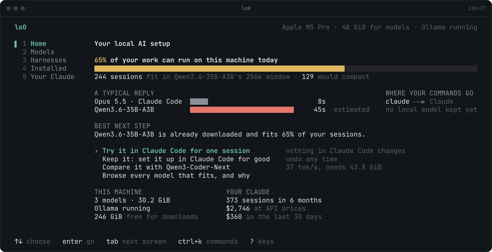

<p align="center">
  
  
</p>

<p align="center">
  <b>Find the local model that fits your machine and your work.</b><br>
  lo0 reads your hardware and your Claude Code and Codex history, shows which open models can do your work, and switches your coding agent over when you're ready.
</p>

<p align="center">
  <a href="https://lo0.ai">lo0.ai</a> ·
  <a href="#install">Install</a> ·
  <a href="#how-it-works">How it works</a> ·
  <a href="#reading-the-report">Reading the report</a> ·
  <a href="#privacy">Privacy</a>
</p>

<p align="center">
  
</p>

lo0 measures how much context your sessions reach, which tools and MCP servers they use, and how much model your hardware can hold. From that it works out which local models fit, what you would give up and how fast they would run. It can then set one up in Ollama, LM Studio or llama.cpp and start Claude Code, OpenCode or Codex on it.

The assessment only reads. Anything that changes your machine is shown as a plan and runs only when you confirm it, and `lo0 migrate --undo` reverses it.

## Install

```bash
curl -fsSL https://lo0.ai/install.sh | sh
```

The script downloads the binary for your macOS or Linux machine from the latest GitHub release, checks it against the release's `checksums.txt` and puts it in `~/.local/bin`. Set `LO0_INSTALL_DIR` to put it elsewhere or `LO0_VERSION=v0.1.0` to pin a release.

On Windows, in PowerShell:

```powershell
irm https://lo0.ai/install.ps1 | iex
```

It does the same checks, installs `lo0.exe` to `%LOCALAPPDATA%\Programs\lo0` and adds that folder to your user `PATH`.

With Go 1.27 or newer, `go install lo0.ai/lo0/cmd/lo0@latest` also works. [lo0.ai/install](https://lo0.ai/install) covers every option and how to uninstall.

## Usage

```bash
lo0
```

In a terminal, `lo0` opens an interactive view with five screens:

- **Home**: how much of your Claude Code and Codex work can run here, how long a typical reply would take against the model you use now, and what to do next.
- **Your sessions**: the verdict, your sessions against local context windows by month and project, and what your history costs at API prices against the plan you pay for.
- **Models**: each model's strengths and weaknesses as its lab states them, how it fits your memory and sessions, and how fast it runs. Compare up to four side by side, press `t` to try one or `b` to measure its speed.
- **Agents**: which parts of your setup carry over to each coding agent lo0 can set up.
- **This machine**: the hardware, the models on disk, and what lo0 changed and how to undo it.

`tab`, `1`–`5` or a click moves between screens, `esc` goes back to Home, `ctrl+k` jumps to anything, `e` saves a shareable report with your project paths removed, and `?` lists every key.

```
lo0 ui                         the interactive view
lo0 web                        the same assessment in your browser, served to this machine only
lo0 match                      the verdict, the models that fit and what carries over
lo0 match --json               the assessment as JSON (schema lo0.match/v1)
lo0 match --gpu "RTX 4090"     your sessions on a card you don't have; also --vram, --gpus, --ram
lo0 match --mac "M4 Max" --memory 128
                               the same for a Mac; ui and web take these flags too
lo0 try                        start the recommended harness on the best model for one session
lo0 try --harness opencode --model ID
                               try another harness or model; its settings stay as they are
lo0 try -- --resume            pass everything after -- to the harness
lo0 benchmark                  measure a downloaded model's reading and writing speed
lo0 migrate                    show the plan for the recommended model and harness, then ask
lo0 migrate --to opencode      move to OpenCode instead of Claude Code
lo0 migrate --to codex         point Codex's config.toml at the local model
lo0 migrate --runtime lmstudio --model ID
                               choose the runtime or the model yourself
lo0 migrate --dry-run --json   the plan as JSON (schema lo0.migrate/v1), changing nothing
lo0 migrate --undo             show how to reverse what migrate changed, then ask
lo0 scan                       the inventory alone: hardware, runtimes, setup, history
lo0 scan --json                the scan as JSON (schema lo0.scan/v1)
lo0 version
```

Every command except `version` also takes:

```
--claude-dir DIR   read Claude Code files from DIR instead of ~/.claude
--codex-dir DIR    read Codex files from DIR instead of ~/.codex
--offline          skip lookups that only add information, such as the newest Claude Code release
```

`scan`, `match`, `try` and `migrate` take `--redact`, which replaces your project paths and home directory so the output can be shared.

Progress goes to stderr and the report to stdout, so `lo0 match > report.txt` captures only the report. Colour is dropped when stdout is not a terminal or `NO_COLOR` is set.

## How it works

| Step | Command | What it does |
|---|---|---|
| **Scan** | `lo0 scan` | Profiles hardware, local runtimes, Claude Code and Codex setups and history |
| **Match** | `lo0 match` | Scores open-weight models against your memory, context needs and tool use, ranks a model under 10 tokens a second below a faster one that holds as many sessions, and says which sessions would not fit and why |
| **Try** | `lo0 try` | Prepares a model in a local runtime and starts Claude Code, OpenCode or Codex on it for one session, without touching their settings |
| **Keep** | `lo0 migrate` | Keeps the setup: a `claude-local` command beside `claude`, or OpenCode or Codex pointed at the model, with your Claude Code and Codex MCP servers, skills, prompts and agents carried over |
| **Undo** | `lo0 migrate --undo` | Reverses everything migrate changed, from the journal it kept as it went |

Try changes only the runtime, for example by downloading the model, and configures the harness through its environment for that one session. Migrate backs up every file it replaces and records each change. Undo reverses it all, except files you have edited since.

[Run Claude Code on a local model](https://lo0.ai/guides/claude-code-local-model) covers the environment Claude Code is given and what keeps working.

### What the scan reads

| Source | Where | What it records |
|---|---|---|
| Hardware | OS, `system_profiler`, `nvidia-smi`, `rocm-smi`, the Windows registry | CPU, memory and whether it is unified, GPUs and VRAM, free disk |
| Local runtimes | Ollama and LM Studio on localhost, model folders, the llama.cpp cache | Installed runtimes and models, with size, quantisation, context length and tool-calling support |
| Claude Code setup | `~/.claude`, `~/.claude.json`, each project's `.claude/` and `.mcp.json`, plugins, managed settings | Instruction files, MCP servers, hooks, commands, subagents, skills, plugins, permission rules |
| Session history | `~/.claude/projects/**/*.jsonl`, `~/.codex/sessions/**/*.jsonl`, `~/.codex/archived_sessions/*.jsonl` | Peak context per session, compactions, tool and MCP calls, languages, repositories, subagent use, tool calls and wait per request, reasoning effort, images, lines changed and pull requests, usage limits and retries, skill loads and hook runs, Claude Code and Codex versions |
| Claude Code | `claude --version`, the Claude app's Claude Code builds, the npm registry | The versions you run and the newest release; the registry lookup sends nothing about you |
| Codex setup | `~/.codex/config.toml`, profile files, `AGENTS.md`, `hooks.json`, `~/.agents/skills`, prompts, agents and rules, and each project's `AGENTS.md` and `.codex/` | Model and providers, MCP servers, instruction files, hooks, skills, custom prompts and agents, rules, plugins |

A missing GPU tool or a malformed transcript line becomes a warning at the end of the report; it does not stop the scan.

## Reading the report

Most of the report is inventory. Three lines carry the verdict.

**Usable by models.** How much memory a model can occupy, weights and KV cache together. On discrete GPUs it is the total VRAM across cards with at least 2 GiB. On Apple Silicon it is the share of unified memory macOS lets the GPU use: about two thirds, or three quarters above 36 GiB.

A mixture-of-experts model too large for the card can keep some experts in system memory, up to the same share of it, with llama.cpp's `--n-cpu-moe`, and lo0 shows how much sits where. Each token reads only a few experts, so writing stays usable, but reading a prompt copies them to the GPU and slows more.

Without a GPU, a model runs on the CPU and gets the same share of system memory. CPUs read long prompts slowly, so lo0 never calls such a machine ready; it estimates how long a typical session takes and suggests `lo0 benchmark` to measure it.

**Peak context.** The largest prompt the model saw in each session, from the token counts in the transcripts, as percentiles across sessions.

**Fits within.** The share of your sessions that would have fitted in a 32k, 64k, 128k, 256k and 1M token window. Most local models top out at 128k or 256k, and long contexts cost memory on top of the weights.

## Privacy

- **Nothing about you leaves your machine.** lo0 goes online to look up releases and to download what a confirmed plan names, from the source the plan names. No request carries your usage profile, paths, prompts or setup, and none goes to a lo0 server. `--offline` skips the lookups.
- **The scan cannot write.** Every scan stage receives an `fs.FS`, which has no write methods.
- **Counts and names, not content.** The profile never holds prompt text, model output, file contents, command arguments or secret values. MCP server `env` and `headers` are reduced to their key names.
- **Paths stay local.** Repository paths appear in your own report. `--redact` and the saved report replace them and your home directory.
- **`lo0 web` stays on this machine.** It listens on the loopback address only, admits a request only with the token it prints and loads nothing from another host.

Tests feed secrets, prompts and command arguments through the scanners and fail if any of them reach the output.

## Model catalogue

Match draws on 36 open-weight models with native tool calling, including Qwen3-Coder, gpt-oss, Devstral, Ministral, GLM, DeepSeek, Kimi, MiniMax, Gemma, Nemotron and Granite. Each entry records parameter counts, attention layout and quantised file sizes, which is enough to work out memory use at a given context length. Models are ranked A to D by how well they hold up in long tool-calling sessions, judged from their published agentic coding scores. The catalogue is generated from [`internal/catalog/sources.json`](internal/catalog/sources.json).

## Platforms

macOS, Linux and Windows on amd64 and arm64, each tested natively in CI. GPU detection covers Apple Silicon, NVIDIA and AMD.

## Development

```bash
make build          # bin/lo0
make check          # vet, staticcheck, golangci-lint and race-enabled tests
make e2e            # the end-to-end tests alone, against a fresh build
make dist           # binaries for every platform and checksums.txt in dist/
make test-install   # run install.sh against dist/ instead of GitHub
```

Linters are pinned in `tools/go.mod` and run through `go tool`, so there is nothing to install globally. Pushing a `v*` tag runs CI at that commit and publishes the binaries it tested.

Read [AGENTS.md](AGENTS.md) before opening a pull request. It sets the architecture, design rules and testing standards.

## The name

`lo0` is the loopback interface on macOS and the BSDs: traffic sent to it never leaves the machine. Say it "L-O-zero" (ell-oh-zero), or "loo" if you're so inclined.

## Licence

lo0 is free software under the [GNU Affero General Public License v3.0](LICENSE). Copyright 2026 Dave Earley.
